<p align="center">
  
</p>

<p align="center">
  
  
  
  
  
</p>

<p align="center"><b>A <a href="https://github.com/radhepa/Village-Friends-Minecraft-Mod">Village Friends</a> add-on that revamps the underground.</b><br>
Somewhere in the rock, rarely, there are places: you break into them while strip-mining,<br>
or stumble on them while caving. Eight of them, each with a story, some still lived in.</p>

---

## The eight delves

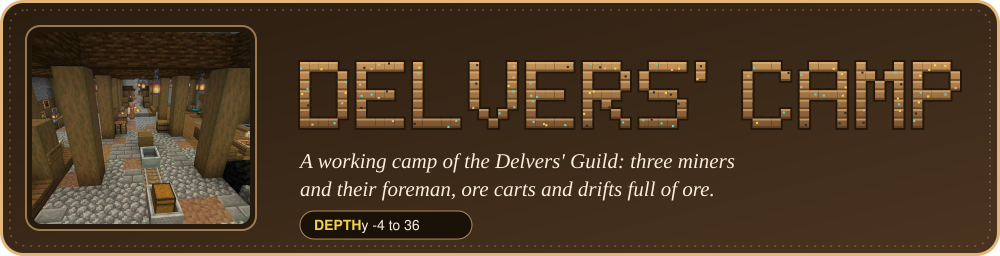

A working mine camp of the Delvers' Guild: three miners and their foreman, bunks, a forge, ore carts on rails, drifts
with walls full of ore. Miners trade and tell you where other delves are.


A Guild camp the roof came down on. Rubble, broken props, a derailed ore cart, the foreman's last log, a cave-spider
nest, and the rich seam that got them killed. The buried shift doesn't rest.

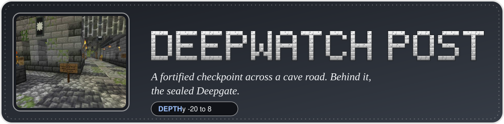

A fortified checkpoint across a cave road, held by the Deepwatch: two knights, two archers and their captain, who
fight what comes up the road. Behind the post, the sealed Deepgate.


A pillared, half-flooded reservoir of the Old Delvers. Swim down to the sunken vault, if the drowned let you.


A mossy cave of giant mushrooms, glow berries and a pond, where an old delver stayed below thirty years ago and never
came up.


A vast amethyst-and-calcite cavern with a still pool and the Old Delvers' crystal shrine.

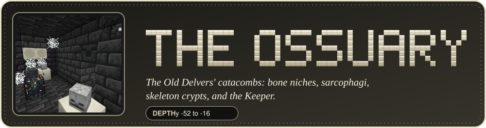

The Old Delvers' catacombs: bone niches, sarcophagi, skeleton crypts, and the Keeper.


An ancient forge-hall over a lava lake, and across the lava, the masterwork vault.

## Rare on purpose

The game offers one spot per 30 x 30 chunk cell (480 blocks square), and a delve only takes it where it fits: in the
test world 47 of 81 cells grew one, about **one delve per 630 x 630 blocks**. Which of the eight it is is weighted;
the Sunken Forge is the rarest (3 of those 47; the others 6 or 7 each). A delve always touches a cave somewhere, so
cavers find them, and sits mostly in solid rock, so strip-miners break into them.

Want them rarer or commoner? `config/caveexpansion.json`:

```json
{ "rarity": 1.0, "rumors": true }
```

`rarity` 2.0 = half as many along each side (a quarter as many in all); 0.5 = twice as many along each side. It only
changes chunks generated afterwards.

## The people below

<table>
  <tr>
    <td width="50%">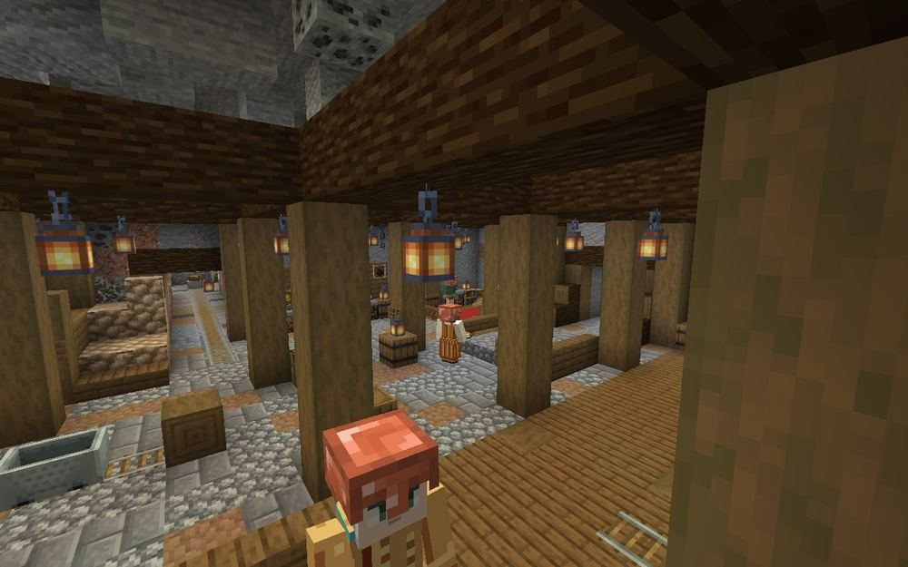<br><sub>The Delvers' Guild at work.</sub></td>
    <td width="50%">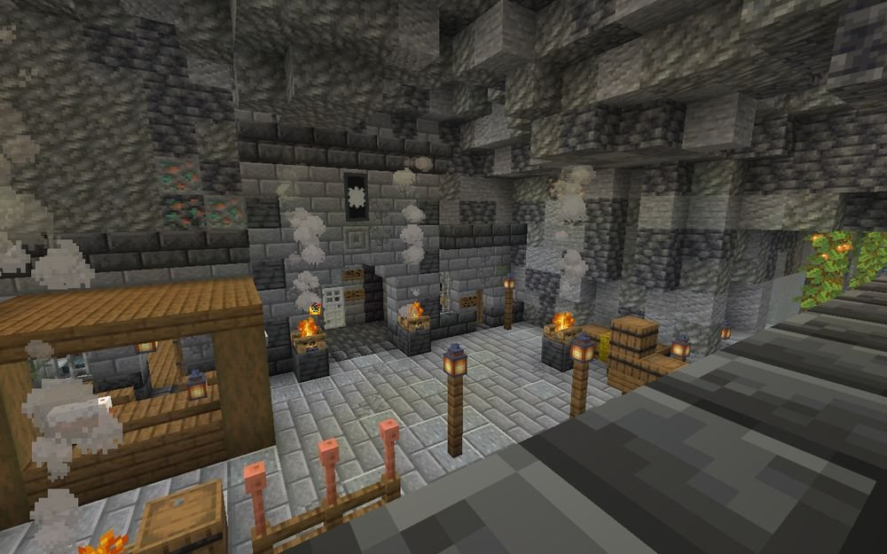<br><sub>The Deepwatch hold the cave road.</sub></td>
  </tr>
</table>

The camp's miners, the Deepwatch and the hermit are Village Friends residents: talk to them in the usual window,
befriend them, give gifts. They have their own lives down there (no tavern, no bell, no weather; the garrison keeps a
night watch) and about 970 lines of their own dialogue. Ask them for news and they'll tell you about the nearest other
delve: what it is, which way and roughly how far.

**The Miner** is a new profession (job site: the **Prospecting Table**). Miners buy coal, copper, iron, gold,
redstone, lapis and diamonds, and sell torches, ladders, lanterns, rails, TNT, copper helmets, picks, and from expert
level (every camp's foreman) a **Delver's Survey Map** to the nearest delve that isn't a camp.

<p align="center">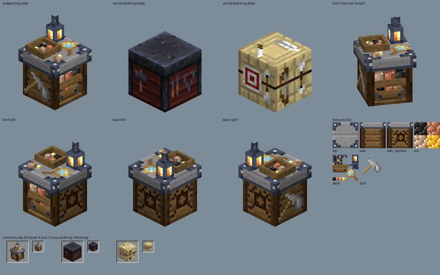<br>
<sub>The Prospecting Table beside vanilla's smithing and fletching tables.</sub></p>

## Guardians

The abandoned delves are dangerous: the first time you come near, their guardians rise. With
[Not-So-Vanilla Mobs](https://github.com/radhepa/Not-so-Vanilla-Mobs) installed they're its Lost Miners, Gravewarden
and Soulpyres; without it, restless miners (zombies in copper helmets), drowned, the Keeper of the Ossuary (a tall
armoured skeleton) and magma cubes.

<table>
  <tr>
    <td width="33%">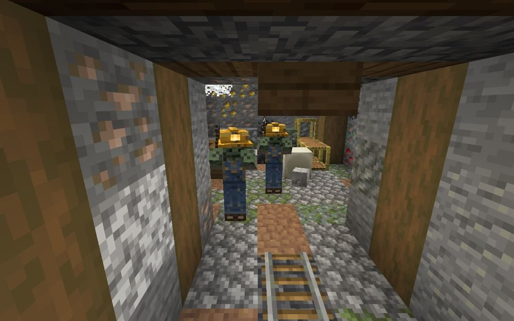<br><sub>The buried shift rises.</sub></td>
    <td width="33%">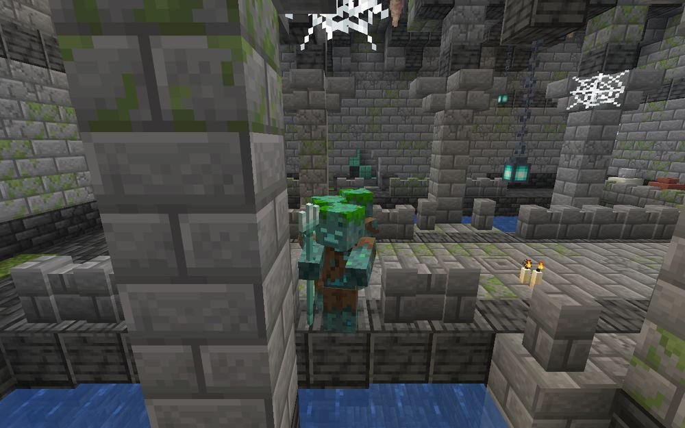<br><sub>The Cistern's drowned.</sub></td>
    <td width="33%">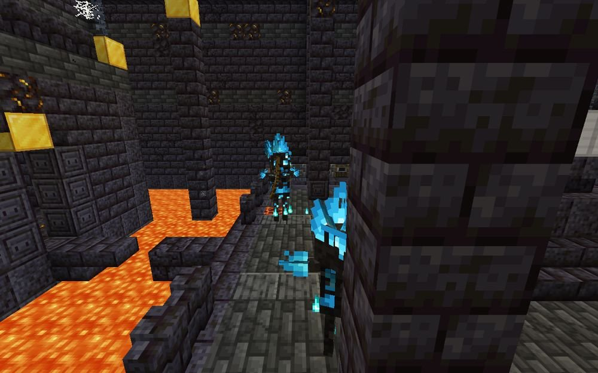<br><sub>Across the lava in the Sunken Forge.</sub></td>
  </tr>
</table>

---

## Plays well with the pack

- Needs **[Village Friends](https://github.com/radhepa/Village-Friends-Minecraft-Mod)** 2.28 or newer.
- **[The Plata Clan](https://github.com/radhepa/The-Plata-Clan)**: delves never generate within 3 chunks of a Scale
  Den or 5 chunks of a Silver Warren, so the clan's burrows and the delves never collide. Miners have heard stories of
  the "silver folk".
- Also keeps clear of villages, Village Friends homesteads, trial chambers, ancient cities, strongholds and ocean
  monuments, and never generates in the Deep Dark.
- **Not-So-Vanilla Mobs**: its mobs guard the delves when installed (looked up by id; no hard dependency).
- **RPG add-on**, **Turning Seasons**, **[End Friends](https://github.com/radhepa/EndFriends)**,
  **[Nether Friends](https://github.com/radhepa/NetherFriends)**: no conflicts (delves are overworld only; residents
  get RPG conversation options like any Village Friends resident).

## Finding one to look at

`/locate structure caveexpansion:camp` (or `seam`, `post`, `cistern`, `hermit`, `grotto`, `ossuary`, `forge`).

## Building

Needs JDK 25 (`JAVA_HOME`) and a Village Friends jar to compile against (`libs/village-friends-<ver>.jar`, or the
VillageFriends launcher instance's mods folder, or `-PvillageFriendsJar=<path>`).

```
python tools/delves/build.py      # structures, pools, loot, trades (from tools/delves/designs/)
python tools/talk/talk.py         # dialogue (from tools/talk/lines/)
gradlew build                     # jar in build/libs/
gradlew runClientGameTest -PtestHeap=2g [-PcaveTests=camp,post] [-PcompatMods=<instance mods folder>]
```

Design notes and the building contract are in [DESIGN.md](DESIGN.md).

## License

[MIT](LICENSE). The README art in `docs/readme/` is drawn from in-game screenshots and the mod's own renders.
